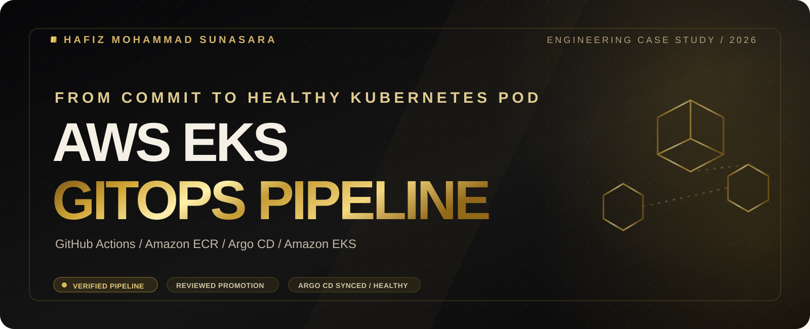
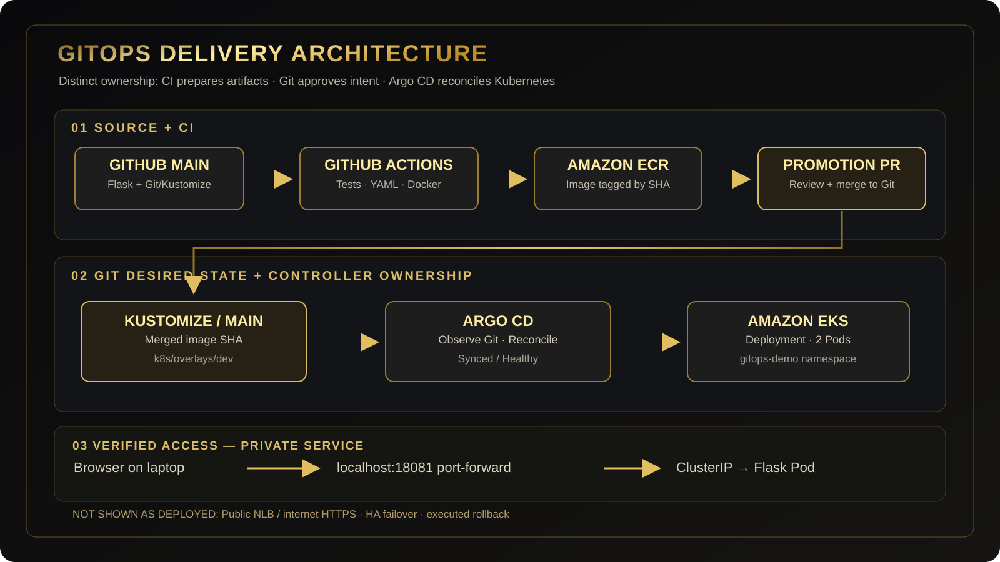
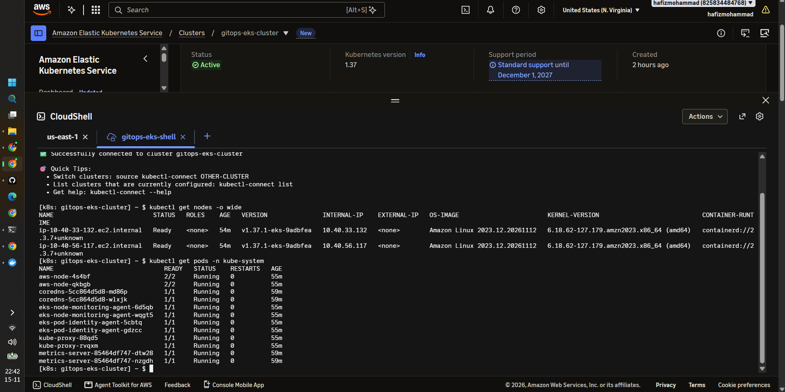
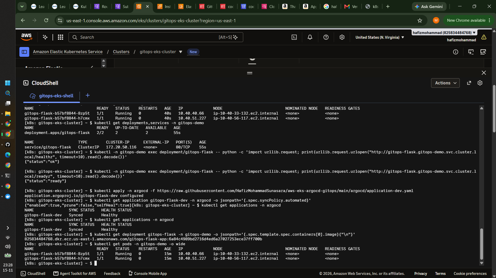
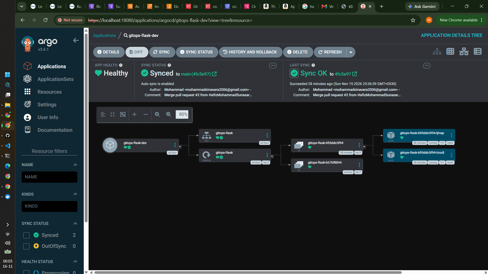
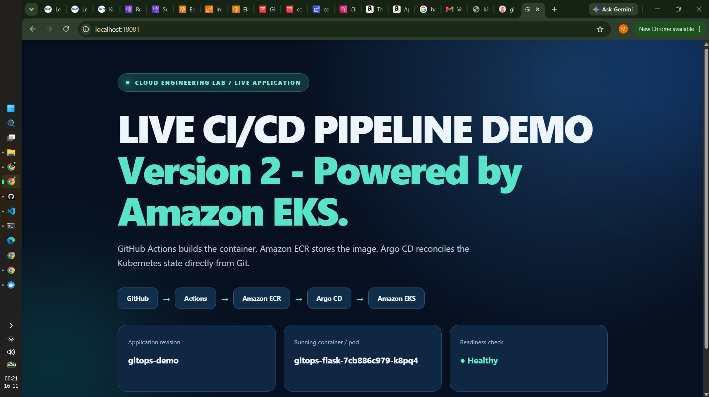

  
    
  
  
  
    
  <strong>HAFIZ MOHAMMAD SUNASARA</strong> 
  Cloud & DevOps Engineering · Technical Portfolio · November 2026

---

# GitOps on Amazon EKS — an evidence-backed engineering case study

**What I built:** A Flask workload on Amazon EKS, backed by GitHub Actions CI, immutable commit-SHA container images in Amazon ECR, a reviewed image-promotion pull request, and Argo CD reconciliation from Git.

**What I demonstrated:** A source-code change progressed through the build-and-promotion workflow and appeared in a new healthy Kubernetes Pod. The final browser capture shows **“LIVE CI/CD PIPELINE DEMO — Version 2 - Powered by Amazon EKS.”**

> **Portfolio separation:** This is the **presentation and evidence repository**. The deployable application and its active CI workflow remain in [aws-eks-argocd-gitops](https://github.com/HafizMohammadSunasara/aws-eks-argocd-gitops). The included [reference-source](reference-source/) directory is a read-only snapshot of that source at commit \`fd9714f7208c351340a471250dca940e90f2a38b\`; it is **not** the deployment source of truth.

  

## At a glance

| Engineering signal | Verified result |
|---|---|
| Container build and automated checks | GitHub Actions passed; tests, manifest validation and Docker build |
| Image storage | Amazon ECR with a full Git commit SHA as the image tag |
| Change approval | GitHub Actions opened an image-promotion PR; [PR #3](https://github.com/HafizMohammadSunasara/aws-eks-argocd-gitops/pull/3) was merged |
| GitOps controller | Argo CD application \`gitops-flask-dev\` reported **Synced / Healthy** |
| Runtime | Amazon EKS, two Ready worker nodes; Flask Deployment desired replicas: two |
| Application health | \`/healthz\` returned \`{"status":"ok"}\`; \`/readyz\` returned \`{"status":"ready"}\` |
| Final user-visible proof | Browser screenshot of updated Version 2 via local port-forward |

**Boundaries matter.** The application was accessed through \`localhost:18081\` with \`kubectl port-forward\`, **not** a verified public internet endpoint. Multi-AZ *worker* presence is not proof of guaranteed cross-AZ Pod spread. A tested Git-based rollback and drift-healing exercise were **not** part of the demonstrated final evidence.

## Follow the actual deployment

1. A trusted change lands on \`main\` in the [application repository](https://github.com/HafizMohammadSunasara/aws-eks-argocd-gitops).
2. GitHub Actions checks Python tests and Kubernetes/Argo manifests, then builds the Docker image.
3. On an eligible \`push\`, GitHub Actions assumes an AWS role with OIDC, pushes a SHA-tagged image to ECR, and opens a promotion PR.
4. The promotion PR changes the image declaration in \`k8s/overlays/dev/kustomization.yaml\`. A human reviews and merges it.
5. Argo CD observes the changed Git desired state and reconciles Kubernetes Deployment/Pods in EKS.
6. Readiness/health checks pass; the new Flask heading appears through local access.

The CI job **does not** use \`kubectl apply\` to deploy the application. Argo CD owns the deployment side.

## Proof, not just diagrams

| Infrastructure | Pipeline and promotion |
|---|---|
|  |  |
| Two Ready EKS worker nodes | Green GitHub Actions run after an earlier failure |

| Argo CD reconciliation | Updated application |
|---|---|
|  |  |
| Healthy/Synced, Service → Deployment → ReplicaSet → Pods | New browser heading and healthy application |

**Full evidence map:** [evidence/INDEX.md](evidence/INDEX.md) · **Before/after:** [15](evidence/screenshots/15-flask-before-change.png) → [16](evidence/screenshots/16-flask-version-2-success.png)

## The failure-to-fix story

The work included an initially OutOfSync/Missing Argo CD application, a historical failed workflow run, and a local port-binding problem on Windows. The case study separates *observed messages* from *root causes actually proved*—there is no invented incident timeline or fake production outage.

Read the technical breakdown in [DEEP-DIVE.md](DEEP-DIVE.md) and the [troubleshooting casebook](docs/06-troubleshooting.md).

## Primary source and immutable proof

| Evidence | Link |
|---|---|
| Original executable project | [aws-eks-argocd-gitops](https://github.com/HafizMohammadSunasara/aws-eks-argocd-gitops) |
| Tested source-code revision | [\`1eda2123\`](https://github.com/HafizMohammadSunasara/aws-eks-argocd-gitops/commit/1eda2123ef3b57054ac444f4842f60438e5d5571) |
| GitHub Actions run #22 | [Open run](https://github.com/HafizMohammadSunasara/aws-eks-argocd-gitops/actions/runs/43748702205) |
| GitHub Actions run #23 | [Open run](https://github.com/HafizMohammadSunasara/aws-eks-argocd-gitops/actions/runs/43748769127) |
| Image-promotion pull request | [Merged PR #3](https://github.com/HafizMohammadSunasara/aws-eks-argocd-gitops/pull/3) |
| Final source state used here | [\`fd9714f7208c\`](https://github.com/HafizMohammadSunasara/aws-eks-argocd-gitops/commit/fd9714f7208c351340a471250dca940e90f2a38b) |

## Explore

| Start here | What you get |
|---|---|
| [DEEP-DIVE.md](DEEP-DIVE.md) | From first principles to the full commit-to-pod journey |
| [docs/01-project-overview.md](docs/01-project-overview.md) | Scope, success criteria, what was actually built |
| [docs/02-architecture.md](docs/02-architecture.md) | Components, control plane, traffic and trust boundaries |
| [docs/03-infrastructure-setup.md](docs/03-infrastructure-setup.md) | EKS and IAM setup and validation |
| [docs/04-cicd-pipeline.md](docs/04-cicd-pipeline.md) | Jobs, conditions, OIDC and SHA promotion |
| [docs/05-argocd-gitops.md](docs/05-argocd-gitops.md) | Argo CD bootstrap and reconciliation |
| [docs/06-troubleshooting.md](docs/06-troubleshooting.md) | Error → observation → fix → proof |
| [docs/07-deployment-verification.md](docs/07-deployment-verification.md) | Evidence and commands to reproduce checks |
| [docs/08-security.md](docs/08-security.md) | Access model, secrets and unresolved hardening work |
| [docs/09-rollback-and-recovery.md](docs/09-rollback-and-recovery.md) | Proposed Git-based rollback procedure, not falsely marked tested |
| [docs/10-cost-and-cleanup.md](docs/10-cost-and-cleanup.md) | Cost-bearing AWS resources and cleanup plan |
| [docs/11-lessons-learned.md](docs/11-lessons-learned.md) | Engineering takeaways |
| [docs/12-roadmap.md](docs/12-roadmap.md) | Next-phase backlog |
| [reference-source/](reference-source/) | Snapshot of the actual deployable repository |

## Black & Gold portfolio website

The responsive single-page showcase lives in [\`docs/index.html\`](docs/index.html), with local CSS/JS and the same screenshot set. To publish it as a static GitHub Pages site in a **new** public repository:

1. Push **the extracted files**, not the ZIP as a single file.
2. Open repository **Settings → Pages**.
3. Set **Deploy from a branch → \`main\` → \`/docs\`**.
4. Wait for Pages to publish. Its URL will have the form \`https://<username>.github.io/<new-portfolio-repo>/\`.

This static showcase does **not** host Flask or replace the existing EKS cluster.

## Safe publication note

Screenshots with visible access keys or admin passwords were excluded. This portfolio includes only selected non-secret captures; source snapshots retain already-public ECR registry identifiers. See [SECURITY.md](SECURITY.md) before publishing. Any old credential exposure must be handled by key/password rotation and log/history review, not by hiding a screenshot alone.

---

**Author:** [Hafiz Mohammad Sunasara](https://github.com/HafizMohammadSunasara) · **Format:** Educational AWS GitOps engineering case study · **License:** MIT
