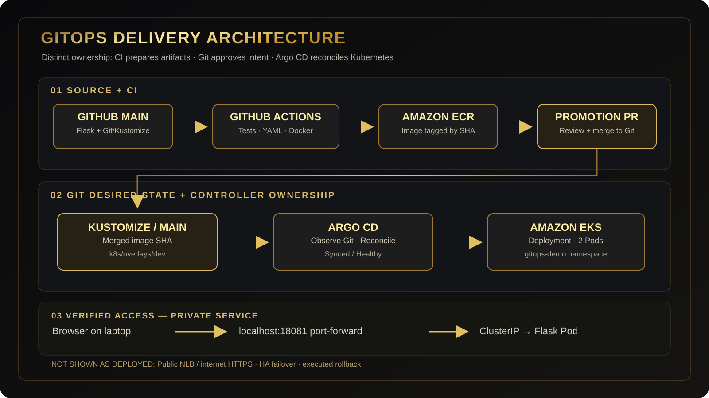

# 02 — Architecture: four boundaries, one release

## Boundary 1 — Source control

GitHub stores Flask code, tests, container recipe, base Kubernetes resources, a Kustomize overlay and the Argo CD Application manifest. This is the declarative artifact set.

The application repository is the **single source of deployment truth**. The portfolio repo is deliberately a separate read-only presentation layer; it must not become a second writer of the application's desired image tag.

## Boundary 2 — CI / artifact factory

GitHub Actions triggers tests and a Docker build. A qualifying main-branch push can publish an ECR image after successful tests. AWS role credentials come from GitHub OIDC rather than a static secret in YAML.

CI passes the image's source SHA into \`scripts/update_image.py\`. The output is a Git change proposed through a pull request, not an API call to EKS.

### Why not \`latest\`?

\`latest\` can't tell an operator which source revision ran. A full Git SHA ties the container identifier to a code revision; a registry image digest is even stronger because it identifies the exact image bytes.

## Boundary 3 — GitOps reconciliation

Argo CD tracks \`main\`, path \`k8s/overlays/dev\`, and the target namespace \`gitops-demo\`. It compares the desired resource manifests with the objects in the cluster and performs a sync. Git manages release intent; Argo CD manages cluster reconciliation.

This permits an audit trail for image updates and helps detect drift from direct cluster edits. **Drift self-healing was configured for the Argo app but a deliberate drift recovery exercise was not captured as completed.**

## Boundary 4 — Runtime/network

The EKS Deployment creates Flask Pods. A ClusterIP Service on port 80 routes to the container's HTTP port 8080. The operator used:

\`\`\`powershell
kubectl -n gitops-demo port-forward --address 127.0.0.1 svc/gitops-flask 18081:80
\`\`\`

This makes the app available at \`http://127.0.0.1:18081\` **on that operator machine only**. The screenshots do not prove any internet-facing load balancer.

## Request path versus deployment path

| Path | Starts at | Finishes at | Key risk |
|---|---|---|---|
| CI | Code push | ECR image / PR | Excessive CI permissions |
| GitOps | Merged Kustomize image tag | Kubernetes Deployment | Drift, wrong target |
| HTTP | Local browser tunnel | Healthy Flask Pod | Unavailable if tunnel closes |

## Runtime hardening captured in manifests

- \`replicas: 2\`, rolling update (\`maxUnavailable: 0\`, \`maxSurge: 1\`).
- Readiness, startup and liveness probes.
- Non-root UID/GID, no privilege escalation, read-only root filesystem, all Linux capabilities dropped.
- CPU and memory requests/limits.
- Soft host topology spreading (\`ScheduleAnyway\`) **without guaranteed placement**.

## Production readiness delta

Before labeling this architecture production-grade: enforce Pod scheduling/failure domains, define PodDisruptionBudget, review network isolation, verify private EKS API access and IAM/RBAC, instrument logs/metrics, run a rollback drill, choose DNS/TLS/public ingress explicitly, and test actual failure recovery.

See [Security](08-security.md) and [Roadmap](12-roadmap.md).
