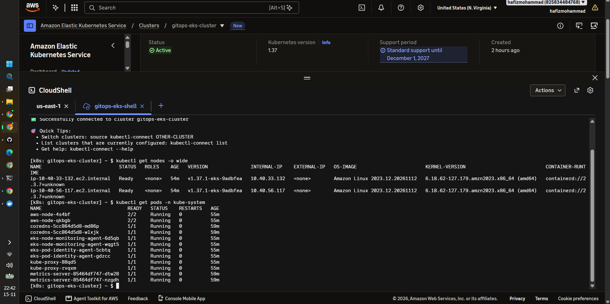

# 03 — Infrastructure setup and validation

This document explains **reproducible checkpoints**. It is not an automatically executable Terraform program or a claim that every AWS Console field was retained in the screenshots.

## 1. Define scope and budget

- AWS Region: \`us-east-1\`.
- EKS cluster: \`gitops-eks-cluster\`.
- Managed node group: \`gitops-eks-workers-1\` in the observed AWS screen.
- Target: two workers, one GitOps demo namespace, private-in-cluster Flask Service.

Record your AWS budget and cleanup strategy **before** creating EKS, EC2 or NAT gateway resources. Closing CloudShell or Chrome does not stop billing.

## 2. VPC and EKS

The AWS account must provide suitable VPC subnets, routes, DNS, security-group configuration, service role and managed-node IAM role. Verify that your selected subnets really route required traffic and that node IAM policies permit EKS worker functionality.

In this lab the EKS Console screenshot showed an **Active** node group and a desired size of two. Later \`kubectl get nodes -o wide\` returned two **Ready** nodes.

Avoid the shortcut of assuming "Cluster = Active" automatically means every node is ready. Check both.

## 3. Establish authorized kubectl context

\`\`\`powershell
aws sts get-caller-identity
aws eks update-kubeconfig --region us-east-1 --name gitops-eks-cluster
kubectl config current-context
kubectl get nodes -o wide
\`\`\`

\`aws eks update-kubeconfig\` writes context information. It doesn't itself grant Kubernetes permissions. If a later \`kubectl get services\` returns **Forbidden**, review EKS access entries/Kubernetes RBAC for the actual IAM principal.

## 4. ECR

The original repository builds images for an ECR repository named \`gitops-flask-app\`. A working publish needs:

- an ECR repository in the same intended Region,
- an IAM role trusted by the correct GitHub OIDC subject,
- narrowly scoped ECR permissions,
- GitHub Actions variables \`AWS_REGION\`, \`AWS_ROLE_ARN\`, \`ECR_REPOSITORY\`.

Do not add an AWS secret access key as a repository variable; roles/OIDC exist to avoid this.

## 5. Kubernetes availability checks

\`\`\`powershell
kubectl get nodes -o wide
kubectl get pods -n kube-system
kubectl get namespaces
\`\`\`

Verify that node status is **Ready** and core system Pods are healthy. The 15 November screenshots documented these states.

## 6. Why the environment wasn't kept permanently public

The final Flask Service remained \`ClusterIP\`. Its browser demo used \`kubectl port-forward\` and an operator's localhost port. An optional public NLB manifest exists in source, but a tested publicly reachable deployment was not part of the final proof.

## 7. Cloud account hygiene

If any screenshots reveal AWS credentials, rotate/revoke them and audit their use. The portfolio excludes such screenshots completely. If the lab is no longer needed, plan an ordered teardown of Kubernetes resources, node group/cluster and associated cost-bearing networking resources. See [cost and cleanup](10-cost-and-cleanup.md).
