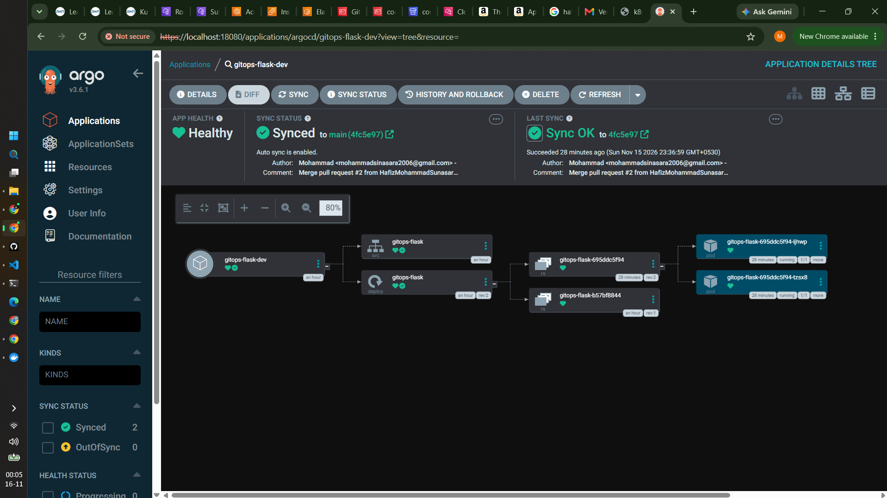

# 05 — Argo CD, Kustomize and the declarative release

## GitOps mental model

A Kubernetes Deployment says what Pods should exist. Kustomize chooses the image for an environment. Argo CD watches the Git version of those manifests and reconciles the cluster toward the declared state.

The Argo CD Application for this lab uses:

- Name: \`gitops-flask-dev\`.
- Source: original GitHub app repository, branch \`main\`.
- Path: \`k8s/overlays/dev\`.
- Destination: in-cluster Kubernetes API and namespace \`gitops-demo\`.
- Automatic synchronization as verified in the terminal, with self-heal shown enabled.

Inspect the exact app definition: [\`reference-source/argocd/application-dev.yaml\`](../reference-source/argocd/application-dev.yaml).

## Bootstrap

Argo CD itself was installed in namespace \`argocd\`. Screenshots show its application controller, repo server, server, Dex and other components Running. The manifest was then applied to define \`gitops-flask-dev\`.

The first observation showed **OutOfSync / Missing**. A subsequent sync operation brought the app to **Synced / Healthy**. That state is supported by both CLI screenshots and the Argo CD UI.

## When a new SHA is merged

Argo CD detects the Kustomize image tag change, renders the desired Deployment and updates the workload. Kubernetes creates a new ReplicaSet as the Pod template changes. Readiness gates help decide when the new instances can receive Service traffic.

### Useful operational commands

\`\`\`powershell
kubectl get applications -n argocd
kubectl get pods -n argocd
kubectl get deployment,service,pods -n gitops-demo
kubectl rollout status deployment/gitops-flask -n gitops-demo --timeout=180s
\`\`\`

The Argo CD dashboard was reached using a local tunnel to the internal \`argocd-server\` Service. Windows port 8080 binding failed; an alternate local port 18080 worked. The port-forward process must stay running while using the dashboard.

## Avoid confusing the following terms

| Term | Meaning |
|---|---|
| \`Synced\` | Desired Kubernetes manifests and live state match in Argo's comparison |
| \`Healthy\` | Argo's health assessment for managed resources is acceptable |
| \`Running\` | A Pod phase; not sufficient by itself for readiness |
| \`Ready\` | The Pod/container satisfies its readiness conditions |
| \`Auto-sync\` | Argo can reconcile Git changes automatically |
| \`Self-heal\` | Configured ability to reapply Git's desired state after drift; not necessarily a tested drill |

## Releasing safely

The reviewable path is to change the Kustomize image tag in Git and merge a PR. Avoid emergency direct \`kubectl set image\` operations that silently diverge from Git; if used during incident response, reconcile the Git source immediately afterward.
