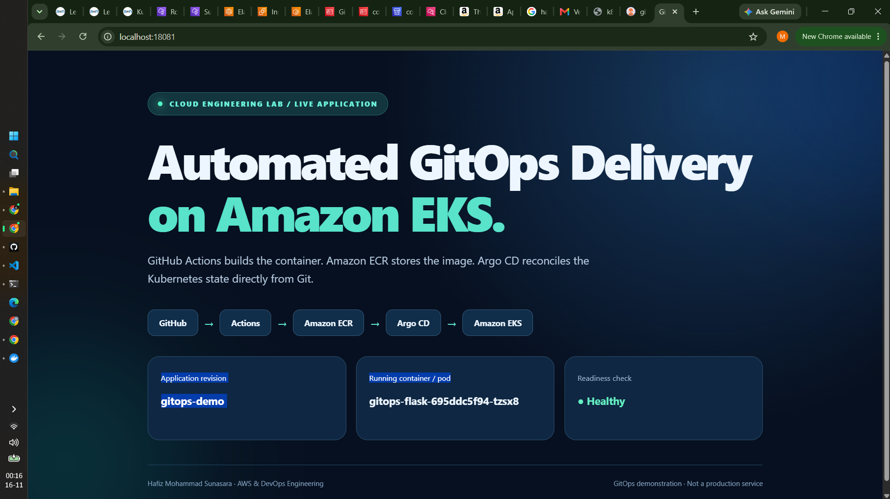
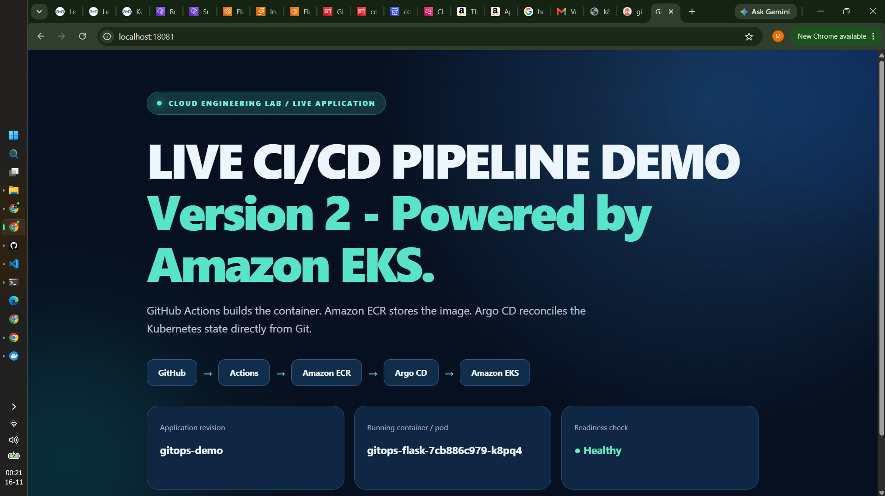

# 07 — Deployment verification: three independent proofs

The project isn't considered demonstrated merely because a workflow badge is green. The proof is a **chain**:

**Passed build → published SHA image → merged Git desired state → Argo Synced/Healthy → running version served over HTTP.**

## Check A — GitHub and image provenance

- Inspect the successful [run #22](https://github.com/HafizMohammadSunasara/aws-eks-argocd-gitops/actions/runs/43748702205).
- Inspect subsequent [run #23](https://github.com/HafizMohammadSunasara/aws-eks-argocd-gitops/actions/runs/43748769127).
- Inspect [PR #3](https://github.com/HafizMohammadSunasara/aws-eks-argocd-gitops/pull/3): merge status, single desired image change, linked source SHA.

**Release source SHA:** \`1eda2123ef3b57054ac444f4842f60438e5d5571\`.

## Check B — EKS and Argo CD

\`\`\`powershell
aws sts get-caller-identity
aws eks update-kubeconfig --region us-east-1 --name gitops-eks-cluster
kubectl get nodes -o wide
kubectl get applications -n argocd
kubectl get deployment,service,pods -n gitops-demo
kubectl rollout status deployment/gitops-flask -n gitops-demo --timeout=180s
kubectl get deployment gitops-flask -n gitops-demo -o jsonpath="{.spec.template.spec.containers[0].image}"
\`\`\`

Compare the final image tag in the Kubernetes Deployment with the merged \`k8s/overlays/dev/kustomization.yaml\`. This is stronger than an Argo badge alone.

Snapshots captured two Ready EKS worker nodes, \`gitops-flask-dev\` Synced/Healthy, a 2/2 Deployment and two Running/Ready Pods.

## Check C — HTTP application and final UI

In an authorized shell with the cluster context:

\`\`\`powershell
kubectl -n gitops-demo port-forward --address 127.0.0.1 svc/gitops-flask 18081:80
\`\`\`

In another local shell:

\`\`\`powershell
Invoke-RestMethod http://127.0.0.1:18081/healthz
Invoke-RestMethod http://127.0.0.1:18081/readyz
\`\`\`

Expected outputs are status \`ok\` and \`ready\`. Open \`http://127.0.0.1:18081/\` in the same workstation's browser.

| Before | After |
|---|---|
|  |  |
| Previous heading | Version 2 heading and a new Pod |

The final heading was \`LIVE CI/CD PIPELINE DEMO — Version 2 - Powered by Amazon EKS.\`

## Verification limitations

- A local port-forward is **not** proof of public availability.
- Two Running Pods during a capture do not prove zonal failover.
- An HTTP 200 from a health endpoint does not prove all downstream dependencies are healthy.
- Rollback/drift recovery have suggested test procedures, but no final before/after execution proof in this pack.
